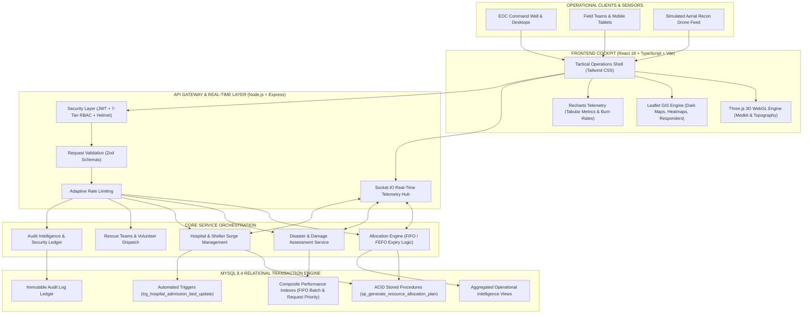

# UrbanResQ — Emergency Operations Center & Disaster Allocation System

[](https://www.typescriptlang.org/)
[](https://react.dev/)
[](https://nodejs.org/)
[](https://www.mysql.com/)
[](https://threejs.org/)
[](https://tailwindcss.com/)
[](https://socket.io/)
[](https://www.w3.org/WAI/standards-guidelines/wcag/)

UrbanResQ is a mission-critical Emergency Operations Center (EOC) and Disaster Resource Allocation Platform engineered for civic crisis coordination, automated FIFO medical inventory dispatch, acute hospital surge triage, and real-time field rescue operations across disaster zones.

---

## Architectural Diagram



---

## System Architecture

### Frontend Cockpit
- **Framework**: React 18 with TypeScript and Vite
- **3D Tactical Visualization**: Three.js WebGL canvas featuring interactive relief medkit, rotational radar telemetry rings, and dynamic topography
- **Geospatial Intelligence**: Leaflet and React-Leaflet with custom high-contrast dark GIS tiles, incident radius overlays, and live GPS responder markers
- **Telemetry & Metrics**: Recharts data visualization with tabular numeral alignment
- **Styling**: Tailwind CSS configured for high-density tactical operations with strict rectangular geometry

### Backend Services
- **Runtime**: Node.js and Express with strict TypeScript modularization
- **State & Telemetry Synchronization**: Socket.IO WebSocket heartbeat and broadcast channels
- **Validation**: Zod schema validation for all incoming payloads
- **Security**: JWT authentication, 7-tier Role-Based Access Control (RBAC), Helmet HTTP headers, bcrypt password hashing, and express rate limiting

### Relational Database & Transactions
- **Database**: MySQL 8.4
- **Concurrency & Integrity**: ACID transactional stored procedures for deterministic FIFO/FEFO batch inventory dispatch
- **Triggers**: Automated hospital ICU bed capacity tracking and immutable audit trails
- **Performance**: Composite indexes on active emergency requests, inventory batches, and audit logs

---

## Core Operational Modules

1. **Operations & Situational Awareness**
   - **Command Center (`/`)**: Cockpit split-pane with global DEFCON status, live Socket.IO connection heartbeat, and interactive GIS canvas.
   - **Disaster Tracking (`/disasters`)**: Multi-tier incident cataloging (Critical, High, Moderate, Low) with geospatial bounding and damage assessments.
   - **Drone Surveillance Feed (`/drone-feed`)**: Real-time simulated aerial reconnaissance feed with altitude, telemetry overlays, and thermal camera modes.

2. **Logistics & Resource Allocation**
   - **Emergency Requests (`/emergency-requests`)**: Intake pipeline for food, water, medical supplies, heavy rescue equipment, and personnel.
   - **Smart Resource Allocation (`/allocations`)**: Atomic allocation engine matching requests against depot inventory using earliest expiration dates (FIFO / FEFO).
   - **Inventory & Depots (`/inventory`)**: Multi-depot supply tracking with real-time stock levels, batch shelf-life monitors, and automatic shortage alerts.

3. **Facilities & First Responders**
   - **Hospitals & ER Surge (`/hospitals`)**: Intensive care unit (ICU) and emergency room capacity tracker with automated admission triggers.
   - **Relief Shelters (`/shelters`)**: Capacity and occupancy monitor with row-locked atomic check-ins.
   - **Rescue Teams & Volunteers (`/rescue-teams`, `/volunteers`)**: Active responder rosters with live GPS coordinates, skill matrices, and dispatch statuses.

4. **Intelligence & System Governance**
   - **Predictive Analytics (`/analytics`)**: Demand projections, response velocity metrics, and resource burn rates.
   - **Database Intelligence & Audit Logs (`/audit-logs`)**: Cryptographic-style immutable audit logs recording all operational decisions and stored procedure executions.

---

## Role-Based Access Control (RBAC)

UrbanResQ enforces 7 distinct operational roles:

| Role | Responsibility | Default Account |
|---|---|---|
| `ADMIN` | System configuration, security policies, and audit oversight | `admin@urbanresq.city` |
| `EMERGENCY_MANAGER` | Incident command, escalation control, and citywide coordination | `manager@urbanresq.city` |
| `RESOURCE_MANAGER` | Warehouse inventory, FIFO dispatch approvals, and depot replenishment | `resources@urbanresq.city` |
| `MEDICAL_COORDINATOR` | Hospital triage, ICU bed allocation, and medical supply requests | `medical@urbanresq.city` |
| `RESCUE_COORDINATOR` | Search and rescue team dispatch, volunteer deployment, and field missions | `rescue@urbanresq.city` |
| `DISASTER_OFFICER` | Damage assessment intake, hazard mapping, and casualty tracking | `officer@urbanresq.city` |
| `VIEWER` | Civic observer access with read-only metrics and status charts | `viewer@urbanresq.city` |

Master password for all demo accounts: `UrbanResQ@2026`

---

## Getting Started

### Prerequisites
- Node.js 18.x or later
- npm 9.x or later
- MySQL 8.0 or 8.4

### 1. Clone the Repository
```bash
git clone https://github.com/bankutech/UrbanResQ.git
cd UrbanResQ
```

### 2. Environment Configuration
Create a `.env` file in the root and in the `backend/` directory:

```env
PORT=4000
CLIENT_URL=http://localhost:5173
DB_HOST=localhost
DB_PORT=3306
DB_USER=root
DB_PASSWORD=your_password
DB_NAME=urbanresq
JWT_SECRET=your_secure_random_jwt_secret_key_32_characters_minimum
JWT_EXPIRES_IN=8h
RATE_LIMIT_WINDOW_MS=900000
RATE_LIMIT_MAX_AUTH=10
```

### 3. Database Initialization
Import the relational schema and stored procedures into MySQL:

```bash
mysql -u root -p urbanresq < database/schema.sql
mysql -u root -p urbanresq < database/procedures.sql
mysql -u root -p urbanresq < database/triggers.sql
mysql -u root -p urbanresq < database/views.sql
mysql -u root -p urbanresq < database/seed.sql
```

### 4. Install Dependencies & Start Services

**Backend Server**:
```bash
cd backend
npm install
npm run dev
```

**Frontend Cockpit**:
```bash
cd frontend
npm install
npm run dev
```

Navigate to `http://localhost:5173` to access the console.

---

## Verification & Testing

Run the full suite of backend integration tests:
```bash
cd backend
npm test
```

Execute the frontend typecheck and production bundle build:
```bash
cd frontend
npx tsc -b
npx vite build
```

---

## Design System & Accessibility

UrbanResQ complies with **WCAG 2.2 Level AA** standards:
- Minimum `4.5:1` color contrast ratio for all operational data and labels.
- Tabular numerals (`tabular-nums`) across all timestamps, coordinates, and counts to prevent visual jitter during live WebSocket updates.
- High-visibility keyboard focus rings for hands-on-keyboard emergency dispatchers.
- Strict 90-degree tactical corners (`rounded-none`) across all cards, dialogs, and inputs.
- Inertial WebGL 3D rendering with graceful fallback.

---

## License

This project is licensed under the MIT License.
