# UrbanResQ — Entity Relationship Diagram

Core relationships (39 tables total; junction/history tables omitted from the visual for readability — see `database-documentation.md` for the full table list).

```mermaid
erDiagram
    USERS ||--o{ USER_ROLES : has
    ROLES ||--o{ USER_ROLES : grants
    ROLES ||--o{ ROLE_PERMISSIONS : has
    PERMISSIONS ||--o{ ROLE_PERMISSIONS : grants

    USERS ||--o{ DISASTERS : creates
    DISASTERS ||--o{ DISASTER_ZONES : contains
    DISASTERS ||--o{ INCIDENTS : has
    DISASTER_ZONES ||--o{ INCIDENTS : located_in
    DISASTERS ||--o{ EMERGENCY_REQUESTS : generates
    DISASTER_ZONES ||--o{ EMERGENCY_REQUESTS : located_in
    LOCATIONS ||--o{ EMERGENCY_REQUESTS : at
    CITIZENS ||--o{ EMERGENCY_REQUESTS : files

    EMERGENCY_REQUESTS ||--o{ REQUEST_STATUS_HISTORY : tracks
    EMERGENCY_REQUESTS ||--o{ RESOURCE_ALLOCATIONS : fulfilled_by
    RESOURCE_ALLOCATIONS ||--o{ ALLOCATION_STATUS_HISTORY : tracks

    RESOURCE_TYPES ||--o{ RESOURCES : classifies
    RESOURCES ||--o{ RESOURCE_INVENTORY : stocked_as
    RESOURCE_INVENTORY ||--o{ RESOURCE_MOVEMENTS : logs
    RESOURCE_INVENTORY ||--o{ RESOURCE_ALLOCATIONS : allocated_from
    RESOURCE_TYPES ||--o{ RESOURCE_SHORTAGES : triggers
    RESOURCES ||--o{ RESOURCE_ALLOCATIONS : allocated_asset

    RESCUE_TEAMS ||--o{ TEAM_MEMBERS : includes
    PERSONNEL ||--o{ TEAM_MEMBERS : belongs_to
    RESCUE_TEAMS ||--o{ VEHICLES : operates
    VEHICLES ||--o{ VEHICLE_DEPLOYMENTS : deployed_as
    EMERGENCY_REQUESTS ||--o{ VEHICLE_DEPLOYMENTS : requests

    HOSPITALS ||--o{ HOSPITAL_BEDS : has
    HOSPITALS ||--o{ HOSPITAL_ADMISSIONS : admits
    EMERGENCY_REQUESTS ||--o{ HOSPITAL_ADMISSIONS : leads_to
    HOSPITAL_BEDS ||--o{ HOSPITAL_ADMISSIONS : assigned

    SHELTERS ||--o{ SHELTER_CAPACITY : snapshots
    SHELTERS ||--o{ SHELTER_RESIDENTS : houses
    CITIZENS ||--o{ SHELTER_RESIDENTS : registered_as

    SUPPLIERS ||--o{ SUPPLY_DELIVERIES : delivers
    RESOURCE_INVENTORY ||--o{ SUPPLY_DELIVERIES : replenished_by

    VOLUNTEERS ||--o{ VOLUNTEER_ASSIGNMENTS : assigned
    EMERGENCY_REQUESTS ||--o{ VOLUNTEER_ASSIGNMENTS : supported_by
    SHELTERS ||--o{ VOLUNTEER_ASSIGNMENTS : supported_by

    EMERGENCY_REQUESTS ||--o{ EMERGENCY_TASKS : breaks_into
    EMERGENCY_TASKS ||--o{ TASK_ASSIGNMENTS : assigned_to

    USERS ||--o{ AUDIT_LOGS : performs
    USERS ||--o{ NOTIFICATIONS : receives
```

## Key normalization decisions

- **`emergency_requests.required_resources_json`** is intentionally JSON rather than a
  fully normalized `request_resource_requirements` join table. The requirement list is
  small (1–3 entries), read far more than written, and the allocation engine reads it
  as a unit — JSON keeps the schema simpler without sacrificing queryability (MySQL 8
  JSON functions + generated columns can index into it if needed later).
- **`resource_allocations`** references *either* `resource_id` (a durable, trackable
  asset like a specific ambulance) *or* `inventory_id` (a consumable stock line like
  bottled water) — enforced by a `CHECK` constraint requiring at least one.
- **History tables** (`request_status_history`, `allocation_status_history`,
  `resource_movements`) are append-only by convention and populated by triggers, so
  the audit trail can never silently drift from the tables it observes.
